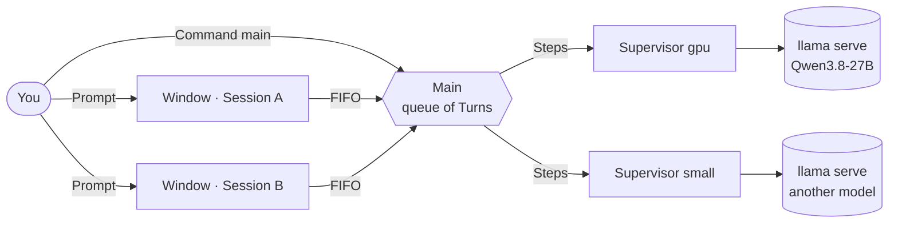

<div align="center">

# AllIn

**Serializing multi-agent prompts on a single RTX 5090, with no need for parallel agents running at once.**


</div>

> [!NOTE]
> AllIn is under active development. The terminal orchestrator, Sessions, Windows and Supervisors already work; function tools, Profiles and submains are on the [roadmap](docs/roadmap.md).

---

## Table of contents

- [The idea](#the-idea)
- [How it works](#how-it-works)
- [Function tools](#function-tools)
- [Safety by design](#safety-by-design)
- [Status](#status)
- [Getting started](#getting-started)
- [Commands](#commands)
- [Development](#development)
- [License](#license)

---

## The idea

A local LLM on one GPU can only answer so much at a time. Instead of running several agents in parallel and fighting over VRAM, **AllIn serializes their work**: each agent waits for its turn, and one model plays every role. Building complex agent structures this way costs **time**, but in return you get **power and context length** from their multi-agent nature, all on the hardware you already have.

AllIn also brings new ideas about **function tools**, and an **asynchronous mode** for when a second LLM plugs in: every Session can be linked to its own Server, so two models can work side by side.

At the centre is **Main**, the process that creates Turns, queues work in arrival order and runs it in a defined order. A Main can create **submains** and call them, which builds a hierarchy of processes that each know what to do and when.

Main opens **Windows**. Each Window shows one **Session**, where you type a Prompt. The Prompt travels to its Main, which turns it into a **Turn** and puts it in the queue.

---

## How it works



| Concept | What it is |
|---|---|
| **Main** | The orchestrator (`python -m allin`). It is the only process that writes the state of its Sessions and keeps their queue of Turns. |
| **Session** | A Conversation with its own Settings, Sysprompt and history, saved on disk. It works with or without a Window. |
| **Window** | An xterm running curses that shows one Session and sends what you type to Main through a FIFO. |
| **Turn / Step** | A Turn is everything a Prompt causes. Each request to the LLM inside it is one Step. |
| **Supervisor** | A named process that launches `llama serve`, relaunches it if it crashes and restarts it with new Settings. It outlives Main. |
| **Enlace** | The Supervisor each Session sends its Steps to. Sessions of the same Main can use different models. |

The full vocabulary lives in [`GLOSSARY.md`](GLOSSARY.md), and every design decision in [`docs/adr/`](docs/adr/).

---

## Function tools

All of these derive from the concept of a **function tool**: a function the LLM calls. There is nothing new in the idea itself, but complex behaviour grows out of these three kinds:

| Kind | What it does | Can be added at run time? |
|---|---|:---:|
| **fsource** | A function tool that runs a command of Main: the way the LLM acts on AllIn itself. | ❌ |
| **fagent** | A function tool written by you or by the LLM. It runs no commands of Main. | ✅ |
| **fscreen** | A class whose methods become tools that control a live **attached process**, which you can also operate directly. | ✅ |

An **fscreen** is the most powerful of the three. A Session with the right methods can drive a running process, for example a client that talks to an API, without writing new code into AllIn. Adding fscreens at run time can grow complex structures of Profiles, work and behaviour: a Profile is a set of Mains, their Sessions and their rules, such as which third-party tools they may use. Without a Sysprompt that guides the implementation, the results are often unexpected.

---

## Safety by design

> [!IMPORTANT]
> An LLM that can run tools must never act with more authority than whoever asked it to.

- **Origin.** Every Prompt and command carries who sent it. Some actions are for a human only, such as the keys that name a file or open the network in a Server's Settings.
- **Confirmations.** Delicate commands, such as putting a Supervisor to sleep or adopting a `llama serve`, ask before they run.
- **Confinement** *(planned, F2)*. Each tool runs in its own process, locked down by Landlock and seccomp to the folders and ports it declares, and never inside AllIn's own data.
- **No silent truncation.** `--context-shift` is refused. A long Conversation is compacted on purpose, never cut behind your back.

---

## Status

| Phase | Scope | State |
|---|---|:---:|
| **F1** | Main, Windows, Sessions, the queue of Turns, recovery after crashes | ✅ |
| **Pre-F2 · Server** | Settings, Notices, Supervisors, restarts, `/server …` | 🚧 |
| **Pre-F2 · Profiles** | Named Profiles, switching, sharing Sessions, Kits | ⏳ |
| **F2** | Confinement, Command sessions, fsource, attached processes | ⏳ |
| **RAG** | Per-Profile memory with embeddings and a reranker | ⏳ |
| **F3** | Submains and handing Sessions between Mains | ⏳ |

Details and order: [`docs/roadmap.md`](docs/roadmap.md) · issues on [GitHub](https://github.com/sayee-444/allin/issues).

---

## Getting started

### Requirements

- 🐧 **Linux** (AllIn reads `/proc` and uses FIFOs)
- 🐍 **Python 3.12+**
- 🖥️ **xterm**, where each Window opens
- 🦙 **[llama.cpp](https://github.com/ggml-org/llama.cpp)**, with `llama serve` on your `PATH`, and a GGUF model
- 📋 **wl-clipboard** (Wayland) or **xclip**, optional: to copy what you select and paste with Ctrl+V

### Install

```bash
git clone https://github.com/sayee-444/allin.git
cd allin
python -m venv venv
venv/bin/pip install -e ".[dev]"
```

### Run

Start a Server yourself, or let a Supervisor start it (see `/server` below):

```bash
llama serve -m model.gguf -c 32000 -np 2 --jinja --port 9931
```

Then start Main:

```bash
venv/bin/python -m allin --data-dir var
```

> [!TIP]
> Already running `llama serve` by hand? `/server adopt gpu` reads its command line and folder and hands them to a Supervisor, so it survives Main and comes back if it crashes.

---

## Commands

Commands are typed in Main's own input. In Main and in every Window, the mouse wheel scrolls the Chat or the input under the pointer, dragging selects text and copies it to the clipboard, and Ctrl+V pastes into the input.

The arrows, Home and End move the cursor in the input, and typing, deleting and pasting happen there. Up on the input's first row brings back the Session's earlier Prompts, and Down past the newest gives back what you were writing.

Enter is never blocked: what you send while the Session's Turn runs waits below the Chat as `[queued]` and runs next. Up on the input's first row withdraws the last queued text back into the input, and Shift+Enter cuts the running Turn, keeps what it wrote, and sends your text ahead of the queue.

In a Prompt you type, `@key=value` changes a sampling parameter for that Turn only (`temperature`, `top_p`, `top_k`, `min_p`, `max_output_tokens`, `presence_penalty`, `frequency_penalty`, `repeat_penalty`, `seed`, `reasoning_budget_tokens`, `effort`), and `@./file`, `@~/file` or `@/path/file` attaches a file. The file is copied to the Session's workspace (`<data dir>/workspaces/<sid>/.allin/adjuntos/`); text goes in as text, and an image goes in as an image only if the Server sees images.

| Command | What it does |
|---|---|
| `/new` | Create a Session and open its Window |
| `/open <sid>` | Open the Window of an existing Session |
| `/send <sid> <text>` | Queue a Prompt for a Session |
| `/session <sid>` · `/session set <sid> key=value…` | Show or change a Session's Settings |
| `/set [--default] key=value…` · `/reset` | Change Main's Settings, or go back to the defaults |
| `/server [name]` | List the Supervisors, or show one's pending and running Settings |
| `/server new\|set\|restart\|adopt\|sleep\|wake …` | Manage Supervisors and their Servers |
| `/raw on\|off [sid]` | Show the raw stream events in Main's Chat |
| `/devastation on\|off` | Let Main answer the Confirmations by itself |
| `/exit` | Close everything cleanly |

---

## Development

```bash
venv/bin/python -m pytest          # tests
venv/bin/basedpyright src tests    # types, strict
venv/bin/ruff check src tests      # lint
venv/bin/python -m scripts.metrics # DORA metrics, coverage and mutation score
```

| Document | Contents |
|---|---|
| [`GLOSSARY.md`](GLOSSARY.md) | The domain language |
| [`docs/adr/`](docs/adr/) | Architecture decisions |
| [`docs/roadmap.md`](docs/roadmap.md) | Phases, order and where the work is now |
| [`CODING_STANDARDS.md`](CODING_STANDARDS.md) | Types, boundaries, errors, threads and naming |
| [`spec.md`](spec.md) | The original project brief, kept as history |

---

## License

[MIT](LICENSE) © 2026 Sayee
